# Programación genética: cómo funciona este proyecto y cómo se hizo rápido

Este documento explica, para alguien que solo conoce lo básico de programación genética
(GP), **todos los conceptos y funciones** del proyecto y **todas las técnicas de
eficiencia** que usan las tres implementaciones: A (Julia, convencional), B (C++20,
convencional, compite en la categoría 1) y C (Julia, no convencional, compite en la
categoría 2).

| Si quieres… | Lee |
|---|---|
| Entender qué es un individuo, el MSE y el ciclo evolutivo | [1. La idea en 5 minutos](#1-la-idea-en-5-minutos) |
| Saber qué hace cada función del manual y cómo se llama en A, B y C | [2. Las funciones del manual](#2-las-funciones-del-manual-una-por-una) |
| Los conceptos de hardware que explican por qué algo es lento | [3. Lo mínimo de hardware](#3-lo-mínimo-de-hardware-para-entender-el-rendimiento) |
| Cómo está hecha cada implementación | [4. Las tres implementaciones](#4-las-tres-implementaciones) |
| **Todas las técnicas de eficiencia**, con dónde están en el código | [5. Catálogo de técnicas](#5-catálogo-de-técnicas-de-eficiencia) |
| Por qué estamos seguros de que todo da el mismo resultado | [6. Verificación](#6-cómo-sabemos-que-todo-da-lo-mismo) |
| Los números | [7. Resultados](#7-resultados) |
| Palabras raras | [9. Glosario](#9-glosario) |

---

## 1. La idea en 5 minutos

**El problema.** Tenemos una tabla de datos con entradas `x1, x2, …` y una salida `y`, y
queremos encontrar **una fórmula** que calcule `y` a partir de las `x`. No le decimos al
programa qué forma tiene la fórmula: la "evoluciona". (Esto se llama *regresión
simbólica*.) El archivo `data/ejemplo.csv` tiene 49 filas generadas con `y = x1 + 0.5·x2`;
un buen resultado es encontrar algo como `(x1 + (x2 * 0.5))`.

**Un individuo es un árbol.** Cada fórmula candidata es un árbol: los nodos internos son
operaciones y las hojas son variables o constantes.

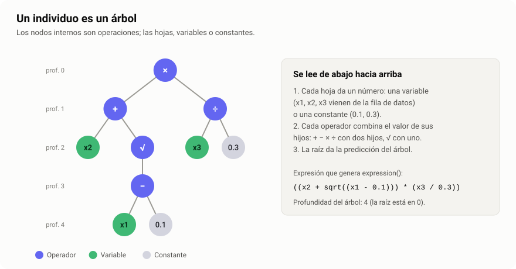

- Operadores: `+`, `−`, `×`, `÷` (con dos hijos) y `√` (con uno).
- Operadores **protegidos** (regla del manual, para que ningún árbol truene):
  `a ÷ b` usa `b = 1e-12` si `|b| < 1e-12`, y `√x` es `√(max(x, 0))`.
- La **raíz está a profundidad 0**; una hoja sola tiene profundidad 0. La profundidad del
  árbol es la de su hoja más profunda.
- `expression()` convierte el árbol en texto y `parse_expression()` hace lo contrario. Con
  17 dígitos el texto no pierde nada, y así las tres implementaciones se pasan árboles.

**¿Qué tan bueno es un árbol? (fitness).** Se evalúa el árbol en cada fila y se promedia el
error al cuadrado: el **MSE**. Menor es mejor.

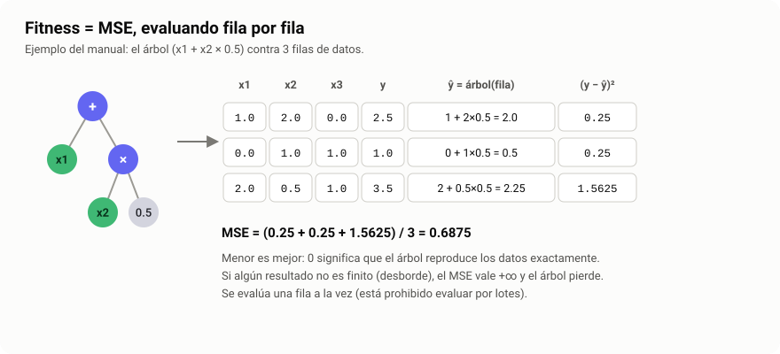

**La evolución.** Se empieza con N árboles al azar y, en cada generación, se eligen padres,
se crean hijos y se conservan los mejores:

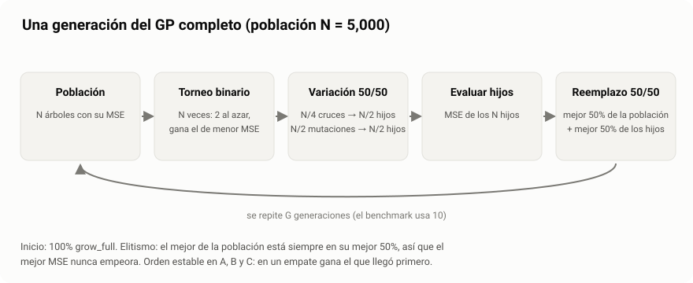

- **Torneo binario:** se toman dos individuos al azar y gana el de menor MSE. Se repite N
  veces para llenar la "bolsa" de padres.
- **Variación 50/50:** la mitad de los hijos sale de cruzar dos padres (crossover) y la
  otra mitad de mutar un padre.
- **Reemplazo 50/50:** la nueva población es el mejor 50% de la actual más el mejor 50% de
  los hijos. Como el mejor individuo siempre está en su mejor 50%, el mejor MSE nunca
  empeora (*elitismo*).

---

## 2. Las funciones del manual, una por una

| Manual | A (`GP_JL_A/src/GPA.jl`) | B (`GP_CPP20_B/src/gp.cpp`) | C (`GP_JL_C/src/GPC.jl`) | Qué hace |
|---|---|---|---|---|
| `expression()` | `expression(n, prec)` | `Node::expression(prec)` | `expression(t, prec)` | Árbol → texto |
| `eval(vector)` | `evaluate(n, x)` | `Node::eval(x)` | `eval_row(t, x)` | Valor del árbol en una fila |
| fitness (MSE) | `fitness(t, data)` | `fitness(t, data)` | `fitness(t, data, S)` | Error cuadrático medio |
| `grow_random` | `grow_random(d, nv, rng)` | `grow_random(d, nv, rng)` | `grow_random(d, nv, rng)` | Árbol de profundidad ≤ d |
| `grow_full` | `grow_full(d, nv, rng)` | `grow_full(d, nv, rng)` | `grow_full(d, nv, rng)` | Árbol con todas las hojas a profundidad d |
| `clone` | `clone(n)`: copia nodo por nodo | `clone(n)`: copia nodo por nodo | `clone(t) = t` (comparte) | Copia independiente |
| `crossover(a, b)` | `crossover` | `crossover` | `crossover` | Dos hijos que intercambian un subárbol |
| `mutation(tree)` | `mutation` | `mutation` | `mutation` | Hijo con un subárbol nuevo al azar |
| `depth_protected_crossover` | igual | igual | igual | Crossover cuyos hijos no pasan `max_depth` |
| `depth_protected_mutation` | igual | igual | igual | Mutación que no pasa `max_depth` |
| `full_gp` | `full_gp(data, opts)` | `full_gp(data, opts)` | `full_gp(data, opts)` | El algoritmo completo |
| benchmark de crossover | `benchmark_crossover` | `benchmark_crossover` | `benchmark_crossover` | Parte 4 B del manual |
| benchmark del GP | `--bench-gp` en `main.jl` | `--bench-gp` en `main.cpp` | `--bench-gp` en `main.jl` | Parte 4 C del manual |

Las tres implementaciones aceptan las mismas opciones de línea de comandos
(`--test`, `--demo`, `--bench-crossover`, `--bench-gp`, `--eval-file`, `--export-trees`).

### 2.1 Crear árboles: `grow_full` y `grow_random`

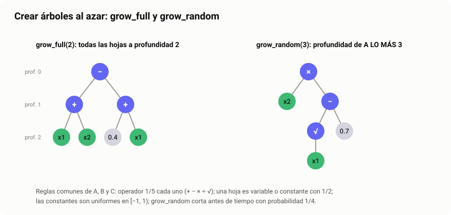

Las tres usan las mismas probabilidades. Un árbol completo de profundidad d tiene en
promedio `1 + 1.8 + 1.8² + … + 1.8^d` nodos: en cada nivel, 4 de cada 5 operadores tienen
dos hijos y 1 de cada 5 (la `√`) tiene uno. Son unos 137 nodos en profundidad 7, unos 2,600
en profundidad 12 y unos 15,200 en profundidad 15.

### 2.2 Clonar

El manual exige que clonar cree una estructura nueva ("copiar la referencia no basta"),
para que modificar al hijo no modifique al padre. A y B copian nodo por nodo. C no
necesita copiar: **sus nodos nunca se modifican**, así que compartirlos es seguro (el
profesor aprobó "compartir subárboles en vez de copiarlos"). Por eso `clone` de C
devuelve el mismo árbol.

### 2.3 Crossover

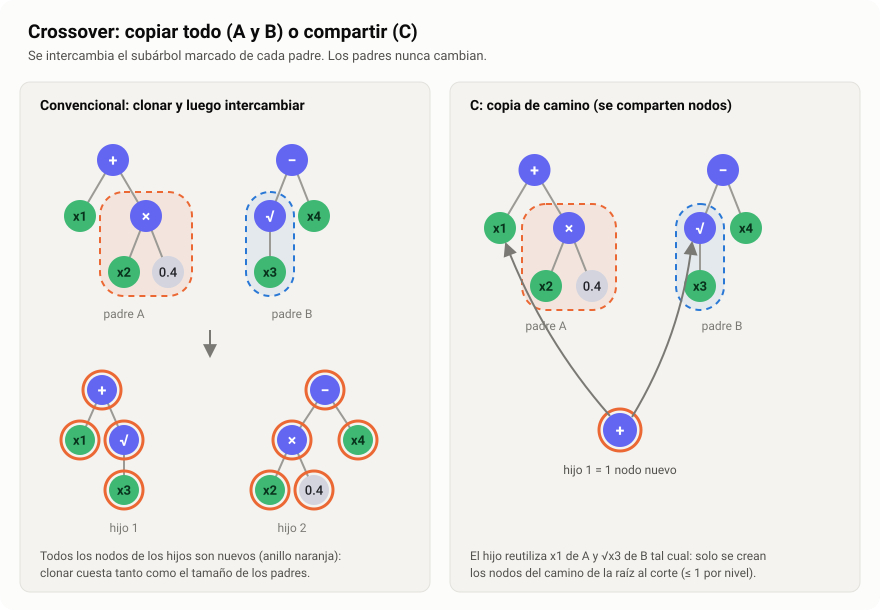

Se elige un nodo al azar en cada padre (uniforme en preorden: raíz, subárbol izquierdo,
subárbol derecho) y se intercambian los subárboles que cuelgan ahí. En A y B el costo es
proporcional al tamaño de los padres; en C, a la profundidad del corte:

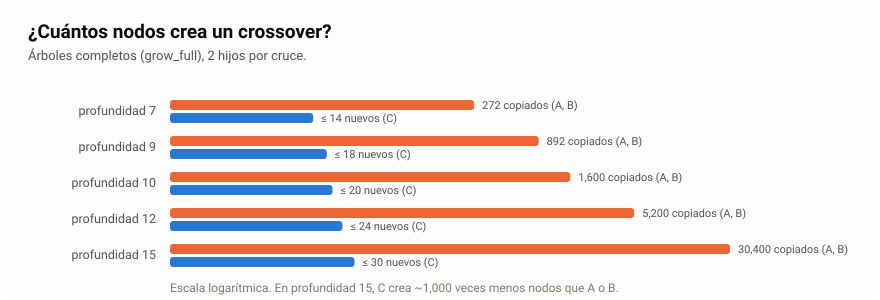

### 2.4 Mutación

Se elige un nodo al azar y se reemplaza su subárbol por uno nuevo de `grow_random`. Es
como un crossover con un árbol recién inventado.

### 2.5 Versiones protegidas por profundidad

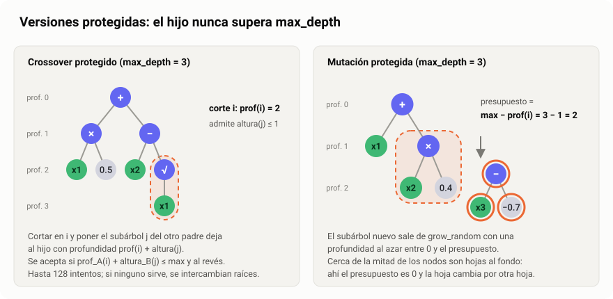

**Por qué la regla es exacta.** Si en el padre A se corta en el nodo i (a profundidad
`prof_A(i)`) y ahí se pone el subárbol j de B (con altura `altura_B(j)`), el hijo mide
`max(lo que queda de A, prof_A(i) + altura_B(j))`. Lo que queda de A ya cabía (el padre
cabe), así que basta revisar `prof_A(i) + altura_B(j) ≤ max_depth` y lo mismo para el otro
hijo. Cada intento se revisa en O(1) si cada punto de corte conoce su profundidad y su
altura.

**Un dato curioso que explica mucho del rendimiento.** En árboles completos (como los de la
población inicial), un nodo a
profundidad k tiene altura `d − k`, y la regla solo se cumple si los dos cortes están **al
mismo nivel**. Como la mayoría de los nodos están al fondo, cerca del 70% de los crossovers
intercambian hojas y casi la mitad de las mutaciones cambian una hoja por otra. **Los hijos
se parecen muchísimo a sus padres**, y por eso el cache de C funciona tan bien.

### 2.6 El GP completo (`full_gp`)

- N debe ser múltiplo de 4: N/4 crossovers dan N/2 hijos y N/2 mutaciones dan los otros N/2.
- Población inicial: 100% `grow_full`. Benchmark: N = 5,000, profundidades 7, 9 y 12
  (cada una en un comando aparte), 100 generaciones (el manual no las fija; se acordó 100),
  semilla 5 en los scripts de benchmark, reportando el mejor MSE de cada generación (`--history`).
  Sin `--seed`, B y C eligen una semilla al azar y la imprimen (A usa 5). Las
  mediciones de la sección 7.1 son de una versión anterior y usan 10 generaciones; las de
  la sección 7.2 usan el protocolo actual.
- Reemplazo con **orden estable**: en un empate de MSE gana el que llegó primero. Las tres
  implementaciones lo hacen igual.

### 2.7 Los dos benchmarks (protocolo acordado con el profesor)

- **Crossover:** 10,000 árboles completos **en memoria al mismo tiempo** (si no alcanza la
  RAM, de 5,000 en 5,000: `--batch-pairs=2500`), profundidades 7, 9, 10, 12 y 15, 5,000
  cruces. Solo se cronometra el crossover. Los hijos se liberan cada 16 cruces, fuera del
  cronómetro.
- **GP completo:** el tiempo total de `full_gp`, con el dataset oficial `datos/dataset3a.csv`.
  El mejor MSE de cada generación se muestra en pantalla mientras corre (por stderr; el
  tiempo de imprimirlo se descuenta y `--quiet` lo apaga) y se escribe en el CSV de
  `--history` después de detener el cronómetro.
- **Un proceso por profundidad**, en los dos benchmarks: `benchmarks/benchmark_A.ps1`,
  `benchmark_B.ps1` y `benchmark_C.ps1` (uno por implementación) o `correr_benchmarks.ps1`
  (las tres, con la verificación cruzada antes de medir).
- **Sin paralelismo:** todo corre en un solo hilo (en Julia, el recolector de basura también
  usa 1 hilo; `correr_benchmarks.ps1` lo registra).
- En Julia, antes de cronometrar se hace una corrida pequeña de calentamiento para que la
  compilación JIT no se cuente.

---

## 3. Lo mínimo de hardware para entender el rendimiento

Casi todas las técnicas de la sección 5 atacan uno de estos cuatro costos:

1. **Ir a la memoria es lento.** El procesador tiene memorias pequeñas y rápidas (caches
   L1, L2 y L3). Leer algo que ya está en L1 cuesta ~1 ns; traerlo de la RAM, ~80-100 ns.
   Además, si se leen posiciones **seguidas**, el procesador adivina la siguiente y la trae
   antes de que se pida (*prefetch*). Seguir punteros a lugares dispersos impide ambas cosas.
2. **Adivinar mal un salto es caro.** En cada `if` o `switch` el procesador adivina hacia
   dónde va el programa y sigue trabajando por adelantado. Si se equivoca, tira ~15-20
   ciclos de trabajo. Un árbol chico se puede "memorizar"; uno de miles de nodos, no.
3. **Crear y destruir objetos cuesta.** Pedir memoria al sistema para cada nodo es lento. En
   Julia, además, el *recolector de basura* revisa de vez en cuando todos los objetos vivos;
   con millones de nodos-objeto eso se vuelve una parte grande del tiempo.
4. **Hacer trabajo que no hace falta.** Recorrer subárboles cuyo valor ya se conoce,
   evaluar hijos que de todos modos se van a descartar, copiar árboles completos para
   cambiar un nodo.

---

## 4. Las tres implementaciones

### 4.1 A: convencional de alto nivel (Julia)

La jerarquía de tipos del manual: `NodeInternal` (operador, izquierdo, derecho),
`NodeVariable` y `NodeConstant`. Es la referencia: no compite y no tiene las
optimizaciones de B y C. C reproduce exactamente sus corridas, lo que sirve para verificar C.

### 4.2 B: convencional de bajo nivel (C++20)

Cada nodo es un objeto independiente enlazado con `std::unique_ptr`; clonar copia nodo por
nodo. Todo lo que se optimizó es "ingeniería" (memoria, evaluación, compilación), sin
cambiar la representación clásica.

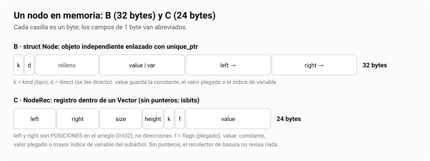

### 4.3 C: no convencional (Julia)

**Toda la población vive en un solo grafo dentro de un arreglo** (aprobado por el
profesor: "toda la población en un solo grafo con caché de resultados"). Cada nodo es un
registro de 24 bytes; los hijos son posiciones en el arreglo. Un árbol es solo el número de
su raíz, y los individuos comparten subárboles. Para evaluar, cada árbol se traduce una vez
a una lista postfija (C12) que se recorre por bloques de 64 filas (C14; fila por fila con
`--no-batch`).

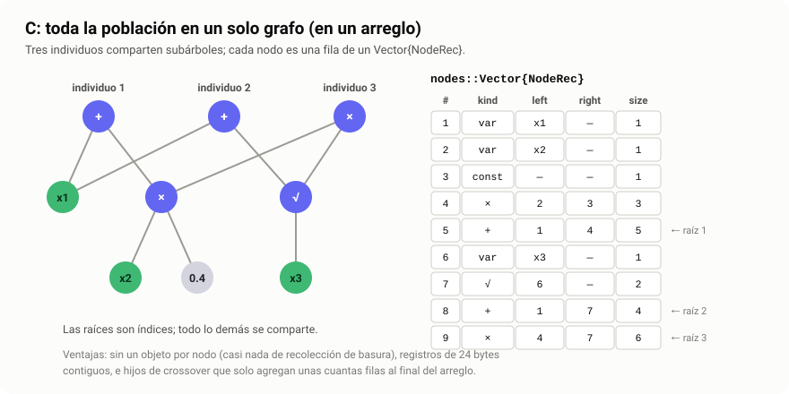

---

## 5. Catálogo de técnicas de eficiencia

Todas dan **exactamente el mismo resultado** que la versión sin la técnica (la sección 6
explica por qué). "Nuevo" = agregado en esta revisión; el resto ya existía.

### Resumen

| # | Técnica | Implementación | Qué ataca | Ganancia medida | Estado |
|---|---|---|---|---|---|
| B1 | Asignador propio de nodos (`NodePool`) | B | crear/destruir | ver README de B | existente |
| B2 | Nodo de 32 bytes con unión valor/índice | B | memoria | ~7 → ~4.8 GB estimados en el benchmark de prof. 15 | existente |
| B3 | Clonar y registrar puntos de corte en una pasada | B | trabajo extra | crossover 1.1-1.6× | existente |
| B4 | Crossover protegido en O(1) por intento | B, A, C | trabajo extra | no recorre los hijos en cada intento | existente |
| B5 | Hojas resueltas en el padre; variables validadas una vez | B | trabajo extra / saltos | ~1.6× con MSVC | existente |
| B6 | **Evaluación sin saltos** | B | saltos | evaluación 1.9× (g++), 2.6× (clang) | nuevo |
| B7 | **Plegado de constantes** | B | trabajo extra | 7-18% del GP | nuevo |
| B8 | **Corte temprano exacto + orden estable** | B | trabajo extra | 8-29% de la evaluación de hijos | nuevo |
| B9 | **Árboles generados en preorden** | B | memoria | crossover 1.4-2.0× | nuevo |
| B10 | Compilación Release con LTO; probar clang-cl | B | código máquina | clang 1.2-1.4× sobre g++ en el GP | recomendación |
| B11 | **Evaluar primero los hijos de mejores padres** | B, C | trabajo extra | 5-6.6% del GP (B, dataset3a) | nuevo |
| B12 | **Hijos idénticos a su padre: MSE del padre, sin evaluar** | B, C | trabajo extra | 5.5-7% del GP (B y C, Windows) | nuevo |
| C1 | Nodos inmutables y subárboles compartidos | C | copias | clonar = 0 | existente |
| C2 | Copia de camino | C | copias | ~1,000× menos nodos en prof. 15 | existente |
| C3 | Metadatos en el nodo (tamaño, altura, mayor variable) | C | trabajo extra | O(1) en vez de O(n) | existente / ampliado |
| C4 | **Toda la población en un grafo en arreglos** | C | recolector de basura, memoria | GC de ~2.6 s a ~0 en prof. 12 | nuevo |
| C5 | **Árboles en preorden** | C | memoria | (con C4) crossover 1.1-1.9× | nuevo |
| C6 | Cache de resultados por nodo, en bloques | C | trabajo extra | generaciones casi gratis | existente / rehecho |
| C7 | **Evaluador sin cache y sin saltos para subárboles chicos** | C | saltos, revisiones | 2.74 → 2.13 ns por nodo y fila | nuevo |
| C8 | **S (tamaño mínimo con cache) elegido por velocidad** | C | trabajo extra | 8-11%; con dataset3a, 30% en prof. 12 | nuevo / ajustado |
| C9 | **Plegado de constantes** | C | trabajo extra | (en el total) | nuevo |
| C10 | **Corte temprano exacto** | C | trabajo extra | 4-7% de las filas (modelo) | nuevo |
| C11 | **Compactación del grafo** en corridas largas | C | memoria | memoria acotada | nuevo |
| C12 | **Lista postfija** (híbrida: hasta 512 instrucciones) | C | recorrer el árbol en cada fila | con C13: 1.8-2.2× del GP (modelo en C++) | nuevo |
| C13 | **Cache al reusarse** en subárboles chicos (4 ≤ tamaño < S) | C | subárboles chicos recalculados | (con C12) | nuevo |
| C14 | **Lista postfija por bloques de 64 filas** (evaluación por lotes) | C | decidir cada instrucción en cada fila | 3.5-4.4× sobre C12 + C13 (modelo en C++) | nuevo; **el profesor dijo que no es válida**; `--no-batch` la apaga |
| A1 | Hijos con una unión concreta de tipos | A, C | despacho dinámico | — | existente |
| P1 | Calentamiento JIT, liberación fuera del cronómetro | todas | medición justa | — | existente |

### B1. Asignador propio de nodos (`detail::NodePool`, `include/gp.hpp`)


**Problema:** `new`/`delete` del sistema para cada uno de millones de nodos es lento (sobre
todo en Windows). **Idea:** `Node` redefine `operator new/delete`; los nodos salen de
bloques de 2 MB y los liberados entran a una lista libre LIFO (lo último liberado, todavía
en cache, se reutiliza primero). `make_unique` y `unique_ptr` lo usan sin cambiar el resto
del código.

### B2. Nodo de 32 bytes (`struct Node`)

Un nodo es constante **o** variable, nunca ambas: `value` y `variable_index` comparten una
`union`. Menos bytes = menos memoria que copiar al clonar y más nodos por línea de cache.
La marca `direct` (B7) cabe en el relleno, así que el nodo sigue en 32 bytes.

### B3. Clonar y registrar los puntos de corte en una sola pasada (`clone_collect`, `clone_shape`)

Antes se recorría cada padre tres veces (clonar, contar nodos, listar puntos de corte).
Ahora el clon se construye y, en el mismo recorrido, se anota dónde cuelga cada subárbol.
Los vectores de puntos de corte se reutilizan entre llamadas (`thread_local`), así que no
se pide memoria en cada crossover.

### B4. Crossover protegido en O(1) por intento (`ShapedSlot`; también A y C)

Cada punto de corte guarda la profundidad del nodo y la altura de su subárbol (sección
2.5). Probar un intento ya no requiere intercambiar y medir los dos hijos: es una suma y
una comparación. Mismos intentos, mismo consumo del generador y mismos hijos que antes.

### B5. Hojas resueltas en el padre y validación única (`operand`, `prepare_tree`)

Cerca de la mitad de los nodos son hojas. En vez de llamar recursivamente a la evaluación
para cada hoja, el padre lee directamente el valor de sus hijos-hoja. Los índices de
variable se validan una vez por árbol (no en cada fila) y se usa un puntero simple en vez
de `std::span`.

### B6. Evaluación sin saltos (`apply_binary`, `direct_value`) — nuevo

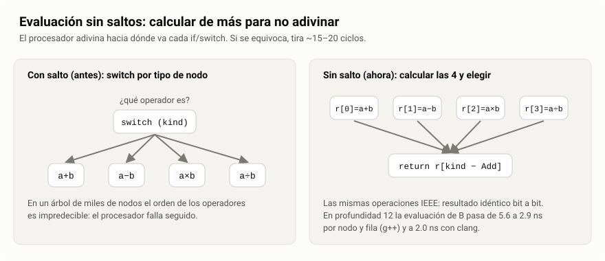

**Problema medido:** en profundidad 12 la evaluación era ~80% del tiempo del GP, y costaba
5.6 ns por nodo y fila contra 2.4 ns en profundidad 7. La diferencia eran saltos mal
adivinados: el `switch` por tipo de nodo no se puede predecir en un árbol de 2,600 nodos.

**Idea:** calcular `a+b`, `a−b`, `a×b` y `a÷b` en un arreglo de 4 y devolver
`r[kind − Add]`; leer una hoja eligiendo la *dirección* (`variable ? x + i : &value`), que
el compilador traduce a una instrucción de selección (`cmov`), no a un salto. La división
se calcula aunque no se use, pero eso cuesta menos que un salto fallado.

| Evaluación, profundidad 12 | antes | ahora |
|---|---|---|
| B con g++ 13 (ns por nodo y fila) | 5.6 | 2.9 |
| B con clang 18 (ns por nodo y fila) | 5.25 | 2.0 |

### B7. Plegado de constantes (`prepare_tree`; `--no-fold` lo apaga) — nuevo

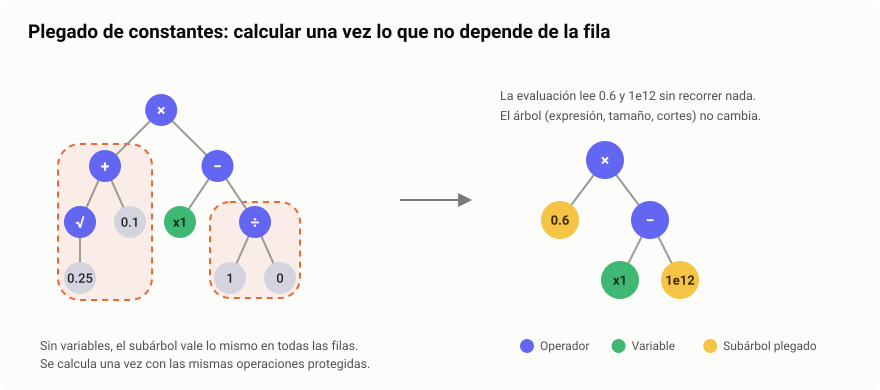

Un subárbol sin variables vale lo mismo en todas las filas. La pasada que ya existía para
validar variables (B5) ahora también calcula, **una vez**, el valor de cada subárbol sin
variables y lo guarda en la `union` del nodo interno; la evaluación lo lee sin recorrerlo.
Se pliega el 17-19% de los nodos internos. Como la pasada se hace en cada `fitness`, las
marcas nunca quedan viejas después de un crossover o una mutación.

### B8. Corte temprano exacto + orden estable (`full_gp`, `mse_impl`; `--no-cut` lo apaga) — nuevo

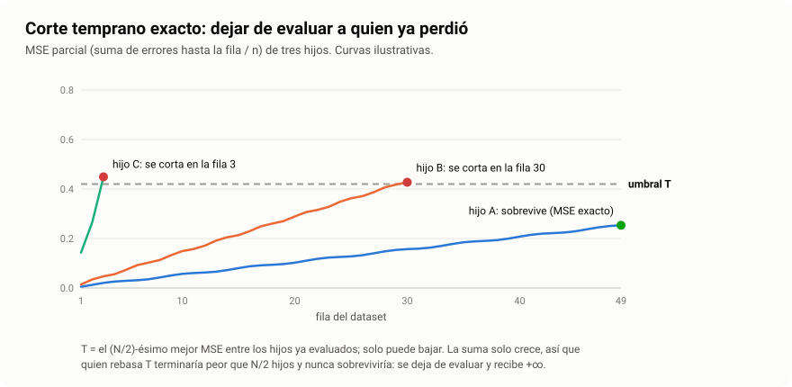

Solo sobrevive el mejor 50% de los hijos. Un montículo guarda los N/2 mejores MSE vistos;
su tope `T` solo puede bajar. Como los errores al cuadrado son ≥ 0, el MSE parcial solo
crece: si ya pasó `T`, el hijo terminaría peor que N/2 hijos y nunca sobreviviría. Se deja
de evaluar y recibe +∞. Los sobrevivientes conservan su MSE exacto.

Para que el resultado sea idéntico con y sin corte hizo falta un **orden estable**
(`stable_sort`): con `nth_element`, el orden de los sobrevivientes dependía de todos los
puntajes (incluso de los descartados) y de la biblioteca estándar, y el torneo elige por
posición. **Esto cambia las corridas de B respecto a versiones anteriores** (mismo
algoritmo, otro orden de sobrevivientes).

Ahorro medido: 8-29% del tiempo de evaluar hijos (más en profundidades chicas).

### B9. Árboles generados en preorden (`grow_impl`) — nuevo

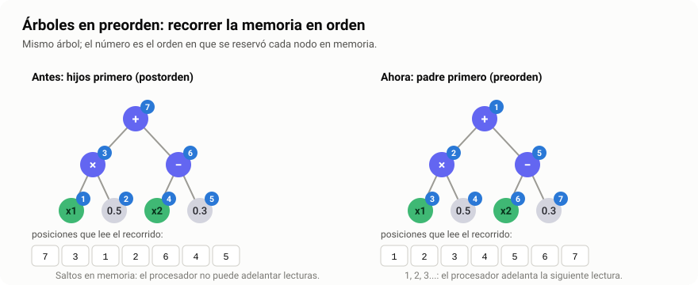

Antes los hijos se creaban antes que el padre (postorden). Ahora el padre se reserva
primero, así que un árbol nuevo queda en memoria en el orden en que lo recorren `clone` y
la evaluación. Clonar un padre "frío" (que no está en cache) lee la memoria en secuencia y
el procesador la adelanta. El generador se consume igual: mismos árboles (lo comprueba
`--test`). En el benchmark de crossover: 1.3-2.0× más rápido.

### B10. Compilación

Release con `/O2 /GL /LTCG` (MSVC) o `-O3 -flto` (g++/clang). La evaluación sin saltos rinde
mucho más con clang (2.0 contra 2.9 ns). En Windows conviene medir **clang-cl** (Visual
Studio Installer → "C++ Clang tools for Windows"; en CMake, toolset `ClangCL`): usa la
biblioteca estándar de MSVC, así que las corridas son las mismas que con MSVC. Confirmar
con el profesor. El proyecto ya trae los presets `x64-clang-release` y
`x64-clang-avx2-release` en `CMakePresets.json`.

### B11. Evaluar primero los hijos de mejores padres (`full_gp`; `--no-order` lo apaga; también C) — nuevo

El corte temprano (B8) necesita un umbral: el (N/2)-ésimo mejor MSE entre los hijos ya
evaluados. Si los hijos se evalúan en el orden en que se crean, el umbral tarda en bajar.
Ahora primero se **crean** todos los hijos (mismo orden y mismo consumo del generador) y
después se **evalúan empezando por los de mejores padres** (el padre del que el hijo hereda
la raíz; orden estable). Los buenos hijos aparecen antes, el umbral baja antes y se dejan de
evaluar más hijos que no pueden sobrevivir. El orden de evaluación no cambia el MSE de
ningún sobreviviente ni el orden de creación, que decide los empates. Medido en B con
dataset3a: 5% a 6.6% menos tiempo del GP completo.

### B12. Hijos idénticos a su padre (`protected_crossover_impl`, `protected_mutation_impl`; `--no-dup` lo apaga; también C) — nuevo

Entre 6% y 15% de los hijos son **idénticos a uno de sus padres** (medido en B con
dataset3a; la proporción sube al final, cuando la población converge):

- un crossover que intercambia dos subárboles iguales (por ejemplo, la hoja `x1` por la
  hoja `x1`) da dos hijos iguales a sus padres;
- una mutación que pone un subárbol igual al que quita;
- el intercambio de raíces (los dos puntos de corte son raíces, o los 128 intentos del
  crossover protegido fallan) da los padres intercambiados.

Mismo árbol, mismo MSE: el hijo recibe el MSE del padre sin evaluar las filas. Detectarlo
cuesta casi nada: al crear el hijo se compara el subárbol que sale con el que entra (casi
siempre una hoja). Las constantes solo cuentan como iguales si tienen los mismos bits. En C,
además, el hijo es el padre mismo: no se copia el camino. Con el corte temprano, el hijo se
registra igual que si se hubiera evaluado (+∞ si su MSE pasa del umbral), así que el GP es
idéntico con y sin `--no-dup`. Es la versión mínima de la detección de duplicados con hash
de Zobrist que usa Operon (Burlacu, 2025): solo detecta copias de un padre, que son la
mayoría.

| Windows, dataset3a, semilla 5 | Prof. 7 (30 gen.) | Prof. 9 (30 gen.) | Prof. 9 (100 gen.) |
|---|---|---|---|
| B con `--no-dup` | 17.18 / 17.21 s | 55.11 / 54.14 s | — |
| B | **16.39 / 16.13 s** (−5.5%) | **50.93 / 50.51 s** (−7.1%) | — |
| C con `--no-dup` | — | — | 52.9 / 55.7 s |
| C | — | — | **51.4 / 50.3 s** (−6%) |

Mismo mejor MSE en todas las corridas (B: 0.305435791 y 0.345015636; C: 0.103945666).

### C1 y C2. Nodos inmutables, subárboles compartidos y copia de camino (`_replace!`)

Ningún nodo cambia después de creado; un hijo de crossover o mutación crea solo los nodos
del camino entre la raiz y el punto de corte (a lo más uno por nivel) y comparte todo lo
demás con sus padres. El costo del crossover pasa de "tamaño del árbol" a "profundidad del
corte" (figuras de la sección 2.3).

### C3. Metadatos en cada nodo (`NodeRec.size`, `.height`, `.value`)

Tamaño, altura y mayor índice de variable se calculan al crear el nodo, en O(1), a partir de
sus hijos. Con el tamaño se encuentra el k-ésimo nodo en preorden bajando desde la raíz
(si k cae dentro del subárbol izquierdo se baja a la izquierda; si no, a la derecha), en
O(profundidad). El mayor índice de variable (guardado en `value` de los nodos internos no
plegados) permite validar el dataset una vez por árbol sin recorrerlo.

### C4. Toda la población en un grafo en arreglos (`Graph`, `NodeRec`, `Tree`) — nuevo

**Problema medido:** antes cada nodo de C era un objeto de Julia. En profundidad 12, la
población inicial tiene ~13 millones de nodos y ~1 millón de vectores de cache: generar los
árboles tardaba 1.96 s (1.37 s de recolector de basura) y evaluarlos 4.17 s (1.24 s de
recolector).

**Idea:** un `Vector{NodeRec}` con registros `isbits` de 24 bytes (sin punteros: el
recolector no tiene nada que revisar adentro). Los hijos son índices `Int32`. Un `Tree` es
(grafo, índice de la raíz). `full_gp` y `benchmark_crossover` usan su propio grafo; se
reserva memoria por adelantado (`sizehint!`) para que el arreglo no se copie al crecer. En
el benchmark de crossover, "soltar los hijos" es recortar el arreglo a su tamaño anterior.

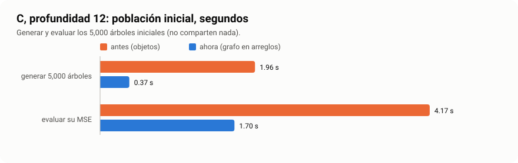

### C5. Preorden en C (`_grow!`)

Igual que B9: el registro del padre se reserva antes que los de sus hijos, así que el hijo
izquierdo de un nodo nuevo está justo después de él en el arreglo.

### C6. Cache de resultados por nodo (`_eval`, `fitness`)


- Los nodos con tamaño ≥ S guardan su valor en cada fila. Los valores viven en bloques de
  8 MB (`Graph.blocks`) y cada nodo guarda dónde empieza su tramo (`cache_off`) y para qué
  dataset es (`cache_id`), en lugar de un vector-objeto por nodo.
- Se llena durante la primera evaluación (fila 1 reserva el tramo; las demás filas lo
  completan), se marca completo al terminar y **se descarta** si el MSE resulta +∞ o si la
  evaluación se corta.
- Un hijo comparte casi todo con sus padres, ya evaluados: solo se calculan los nodos
  nuevos del camino y los subárboles pequeños que cuelgan de él. En profundidad 12, las
  10 generaciones juntas cuestan menos que la población inicial.

### C7. Evaluador para subárboles pequeños (`_eval_small`, `apply_select`, `_direct`) — nuevo

Debajo de S ningún nodo tiene cache, así que se usa una función aparte que no lo revisa.
Elige el operador con `ifelse` (selección, sin salto), lee las hojas sin salto y recibe el
**índice** del nodo, no su registro: pasar un registro de 24 bytes obliga a Julia a
copiarlo en la pila en cada llamada recursiva.

| Subárbol sin cache, profundidad 12 (ns por nodo y fila) | |
|---|---|
| con saltos, pasando el registro | 3.15 |
| `ifelse`, pasando el registro | 2.74 |
| `ifelse`, pasando el índice (versión final) | 2.13 |

### C8. S elegido por velocidad (`auto_cache_min_size`) — nuevo

Un S chico ahorra trabajo en las generaciones, pero llenar el cache de la población
inicial cuesta. Barrido medido (segundos por corrida, promedio de 3 semillas):

| Profundidad | S=4 | S=8 | S=16 | S=32 | S=64 | S=128 |
|---|---|---|---|---|---|---|
| 7 | 0.52 | 0.48 | **0.42** | 0.47 | — | — |
| 9 | — | 0.92 | 0.84 | **0.82** | 1.04 | — |
| 12 | — | — | 3.12 | **2.76** | 2.76 | 3.17 |

Regla: S = 16, o 32 en profundidad ≥ 11, y más grande si la estimación del cache pasa de
**4 veces** `--cache-mb` (1024 MB por defecto). La estimación es muy conservadora, y la
memoria real la acota la compactación del grafo (C11).

**Ajuste con el dataset oficial.** Con dataset3a (961 filas, contra 49 de `ejemplo.csv`)
cada resultado guardado ocupa unos 7.7 KB, y la regla anterior (límite de 1 vez el
presupuesto) subía S hasta 256 en profundidad 12, donde casi no queda cache. Barrido en
Windows (semilla 1, 10 generaciones, mismo MSE en todas):

| S | Prof. 7 | Prof. 9 | Prof. 12 |
|---|---|---|---|
| 16 | **6.14 s** | 12.40 s | 72.4 s |
| 32 | 6.80 s | **11.59 s** | 39.9 s |
| 64 | 9.16 s | 14.16 s | **39.1 s** |
| regla anterior (16, 32, 256) | 6.18 s | 12.25 s | 53.6 s |

La regla actual elige 16, 16 y 64: en profundidad 12 baja de 53.6 s a 37.4 s, con un pico
de unos 4 GB de RAM. Subir `--cache-mb` a 4096 no era más rápido y subía el pico a 8.7 GB.

### C9. Plegado de constantes en C (`_op_record`; `--no-fold` lo apaga) — nuevo

Como los nodos de C no cambian, el plegado se hace **al crear el nodo**: si sus hijos son
constantes o están plegados, calcula su valor (mismas operaciones protegidas) y lo guarda.
Nunca queda viejo: un hijo de crossover crea nodos nuevos en el camino, y cada uno calcula
el suyo.

### C10. Corte temprano exacto en C (`_score_child!`, `_record_best!`; `--no-cut` lo apaga) — nuevo

La misma idea de B8. C ya usaba orden estable (`MergeSort`), así que su corrida sigue
siendo idéntica a la de A, que no corta. Ahorra poco en C (4-7% de las filas, medido en un
modelo del diseño) porque sus hijos ya son baratos de evaluar gracias al cache.

### C11. Compactación del grafo (`_compact`) — nuevo

El grafo solo crece. En corridas largas, cuando el cache ocupa el doble de `--cache-mb`,
se copian a un grafo nuevo solo los árboles vivos (conservando lo que comparten y su
cache). En el benchmark (10 generaciones) no llega a ocurrir; `--test` la fuerza y
comprueba que no cambia el resultado.

### C12. Lista postfija (`_compile!`, `_run_tape`, `_fitness_tape`; `--no-tape` la apaga) — nuevo

En un modelo de C escrito en C++, el 93% del tiempo del GP era evaluar los hijos, y casi
todo eso era recorrer el árbol: en cada fila, la recursión vuelve a leer el registro de cada
nodo del camino, revisa su cache y llama a la función del hijo (en el modelo, unos 13 ns por cada nodo del camino y por fila).

- Antes de evaluar, el árbol se traduce **una vez** a postfijo: hijo izquierdo, hijo
  derecho, operador. Cada instrucción (`TapeOp`, 24 bytes) apila una variable, una
  constante o el cache de un nodo, aplica un operador o guarda el tope de la pila en el
  cache de un nodo. Un nodo con cache completo es una sola instrucción: su subárbol ni
  siquiera se recorre.
- Después, **para cada fila**, se recorre la lista con una pila: cada fila pasa por todo el
  árbol antes de empezar la siguiente. Así es con `--no-batch`; por defecto, C14 recorre la
  lista por bloques de 64 filas.
- **Híbrido**: con más de 512 instrucciones (`TAPE_MAX`) se usa la recursión. En la
  población inicial de profundidad 12 hay árboles de miles de nodos sin nada en cache; con
  listas tan largas el procesador ya no adivina la siguiente instrucción y la lista fue 2.5
  veces más lenta (91 s contra 37 s en la población inicial del modelo). Los hijos, que leen
  del cache casi todo lo que comparten, tienen listas cortas.
- El cache de los nodos grandes solo se reserva si de verdad se usa la lista
  (`_resolve_stores!`); si el árbol cae en la recursión, la recursión lo llena como antes.

### C13. Cache al reusarse (`--reuse-min-size=K`, 4 por defecto; 0 lo apaga) — nuevo

Con S = 16, un subárbol de 4 a 15 nodos nunca tiene cache, y cada hijo que lo contiene lo
recalcula en las 961 filas. Bajar S para todos no cabe en memoria (con S = 4 en profundidad
9 el modelo se quedó sin memoria). En cambio, los nodos con K ≤ tamaño < S guardan cache
**la segunda vez** que se evalúan; la primera solo se marcan (`SEEN` en `cache_id`). Así
gastan memoria solo los subárboles chicos que reaparecen. A diferencia del "cache perezoso"
que se descartó (abajo), los nodos de tamaño ≥ S siguen guardando cache desde la primera vez.
Solo guarda el subárbol chico **más externo**: los nodos de adentro no guardan, porque la
próxima vez se lee el de afuera. Sin esa regla, en profundidad 15 (S = 512) cada hijo
guardaba cientos de subárboles anidados (modelo: 5.9 GB contra 2.0 GB con 2,000 árboles).

| Modelo de C en C++, dataset3a, población 5,000, 100 generaciones | Prof. 7 | Prof. 9 | Prof. 12 |
|---|---|---|---|
| Antes | 35.1 s | 53.5 s | 148.4 s |
| C12 + C13 | 18.3 s | 29.8 s | 66.0 s |
| Pico de RAM antes / después | 2.3 / 2.3 GB | 2.5 / 2.6 GB | 4.2 / 5.1 GB |

El modelo usa las mismas estructuras y la misma lógica que C (calibrado: 37.5 s contra
36.6 s de Julia en profundidad 7) pero otro generador aleatorio. Su historial del mejor MSE
es idéntico con y sin C12 y C13 en las tres profundidades. Falta medirlo en Julia
(`--no-tape --reuse-min-size=0` da la versión anterior).

### C14. Lista postfija por bloques de filas (`_run_tape_batch!`, `_fitness_tape_batch`; `--no-batch` la apaga) — nuevo

> **El profesor dijo que la evaluación por lotes no es válida para C.** Se agregó y quedó
> encendida por decisión del equipo; `--no-batch` regresa a fila por fila con el mismo
> resultado.

La lista de C12 se recorre una vez por bloque de 64 filas en vez de una vez por fila. Cada
lugar de la pila es una columna de 64 valores: una variable apila su columna (el dataset
guarda las columnas seguidas, `Dataset.cols`), un nodo con caché apila su tramo y un
operador combina las dos columnas de arriba. Decidir cada instrucción, lo que dominaba en
C12, se paga una vez por bloque; por eso no hace falta `TAPE_MAX`. La suma del error sigue
fila por fila, en el mismo orden y con el mismo corte: el MSE es idéntico bit a bit.

| Modelo de C en C++, dataset3a, población 5,000, 100 generaciones | Prof. 7 | Prof. 9 | Prof. 12 |
|---|---|---|---|
| C12 + C13 (lista fila por fila) | 17.4 s | 29.8 s | 66.0 s |
| C12 + C13 + C14 (por bloques) | 4.7 s | 8.4 s | 15.0 s |

Mismo historial del mejor MSE en las tres profundidades. Falta medirlo en Julia.

### A1. Hijos con una unión concreta de tipos (A y la versión anterior de C)

`left::Union{NodeInternal, NodeVariable, NodeConstant}` en vez del tipo abstracto `Node`:
Julia sabe en compilación qué método llamar y la recursión no paga despacho dinámico.

### P1. Medición justa (todas)

Calentamiento JIT fuera del cronómetro; en el benchmark de crossover, generar padres y
liberar hijos (cada 16 cruces) quedan fuera del cronómetro; un solo hilo.

### Ideas que se evaluaron y no se usan

| Idea | Por qué no |
|---|---|
| Evaluación por lotes en A | El profesor dijo que no es válida (en C); el equipo la usa en B y en C (C14), no en A |
| Paralelismo | **Prohibido** por el profesor |
| Lista postfija también en árboles largos | 2.5× más lenta que la recursión con miles de instrucciones (por eso C12 es híbrida) |
| Cache "perezoso" en todos los nodos (guardar hasta el segundo uso, también los ≥ S) | Medido en un modelo: mucho peor en prof. 12 (4.8 → 6.2 s); C13 lo usa solo en los chicos |
| Bajar S a 4 para todos los nodos | El cache de la población inicial no cabe en memoria (profundidades 9 y 12) |
| Reordenar las filas para que el corte temprano llegue antes | Corta pocas filas más y el reordenamiento cuesta: más tiempo en el modelo |
| Unir subárboles idénticos creados por separado (hash-consing) | Casi no hay repetidos: las constantes son aleatorias |
| Prefetch manual al clonar; pila de libres en arreglo | Sin ganancia clara medida |
| Crossover "fusionado" sin lista de puntos de corte en B | Como máximo 15-20%; cambia la estructura del código convencional |
| Evaluador híbrido en B (con saltos si el árbol es chico) | Sin ganancia consistente medida |
| Diferir la recolección de basura fuera del cronómetro del GP | Sería esconder trabajo, no ahorrarlo |
| Evaluación incremental con propagación fallida (Langdon) | C ya recalcula solo el camino nuevo; lo que cuesta son los subárboles chicos cerca del corte, que esto no evita |
| Evaluar en SIMD varias filas, hilos, GPU | Son evaluación por lotes o paralelismo: prohibidos |
| Optimizar constantes por búsqueda local; agregar seno | Mejoraría mucho el MSE, pero cambia el algoritmo y los operadores del manual |

**Pendientes de medir o de preguntar al profesor:** medir C12 y C13 en Julia, y guardar en
cache, por valor de la variable, los subárboles que dependen de una sola variable (dataset3a es una
cuadrícula de 31 × 31, así que solo hay 31 valores de x1 y 31 de x2; cerca de la mitad del
trabajo de evaluar la población inicial está en esos subárboles).

---

## 6. Cómo sabemos que todo da lo mismo

**Por qué es bit a bit.** La aritmética de punto flotante (IEEE 754) es determinista: la
misma operación sobre los mismos números da siempre el mismo resultado. Ninguna técnica
cambia qué operaciones se hacen ni en qué orden se suman las filas:

- la evaluación sin saltos calcula de más, pero **elige** el mismo resultado;
- el plegado calcula una vez el mismo valor que se calcularía en cada fila;
- el cache guarda valores, no los cambia (también el que se guarda al reusarse);
- la lista postfija hace las mismas operaciones, en el mismo orden, que la recursión, y
  recorrerla por bloques de filas solo cambia cuándo se calcula cada fila, no cómo;
- el corte temprano solo afecta a hijos que de todos modos se descartan;
- un hijo idéntico a su padre tiene el mismo MSE que su padre;
- el orden en que se evalúan los hijos no cambia el MSE de ninguno;
- el preorden cambia dónde quedan los nodos en memoria, no qué árbol se genera.

**Pruebas que lo comprueban** (todas pasan):

| Comando | Qué comprueba |
|---|---|
| `gp_b --test` | Lo anterior, más: MSE idéntico a `Node::eval` en 400 árboles con datos extremos (con y sin plegado, también en hijos de crossover y mutación), plegado, preorden con el mismo consumo del generador, detección de hijos idénticos a su padre (mismos hijos y mismo consumo del generador en 3,000 cruces y mutaciones), y el GP igual con y sin `--no-fold --no-cut --no-order --no-dup` |
| `julia GP_JL_C/main.jl --test` | 1,582 comprobaciones (1,598 con las de C12 a C14, que falta correr en Julia): registro de 24 bytes, operador sin saltos = con saltos (Inf, NaN, ceros), preorden, plegado, cache con y sin plegado, corte temprano, lista postfija alternada con la recursión (con y sin plegado, varios S y K, otro dataset, corte temprano e hijos), copia de camino, detección de hijos idénticos a su padre, tamaño automático del cache con 961 filas, y el GP igual con/sin cache, plegado, corte, orden, `--no-dup`, lista postfija, cache al reusarse y compactación |
| `julia GP_JL_A/main.jl --test` | 1,116 comprobaciones de A |
| `julia GP_JL_C/tools/cross_check.jl` | 56,116 comprobaciones: A y C generan los mismos árboles, los mismos hijos y la misma corrida completa |
| `julia GP_JL_C/tools/verificar_con_b.jl gp_b` | 3,280 árboles generados por B evaluados por A, B y C: mismo MSE bit a bit |

`correr_benchmarks.ps1` corre todo esto antes de medir.

---

## 7. Resultados

### 7.1 Versión anterior, contenedor Linux, `ejemplo.csv`, 10 generaciones

Medido en un contenedor Linux (Intel Xeon 2.1 GHz, un hilo), g++ 13.3 y clang 18.1 con
`-O3`, Julia 1.13.4 con `-O3`, `data/ejemplo.csv` (49 filas). "Antes" es el commit
`4561dac`, compilado y medido en el mismo equipo. Mediana de 3 semillas. En el equipo del
torneo (Windows, MSVC) los tiempos serán otros; las proporciones deberían parecerse. Los
datos crudos están en [`resultados_contenedor/`](resultados_contenedor/).

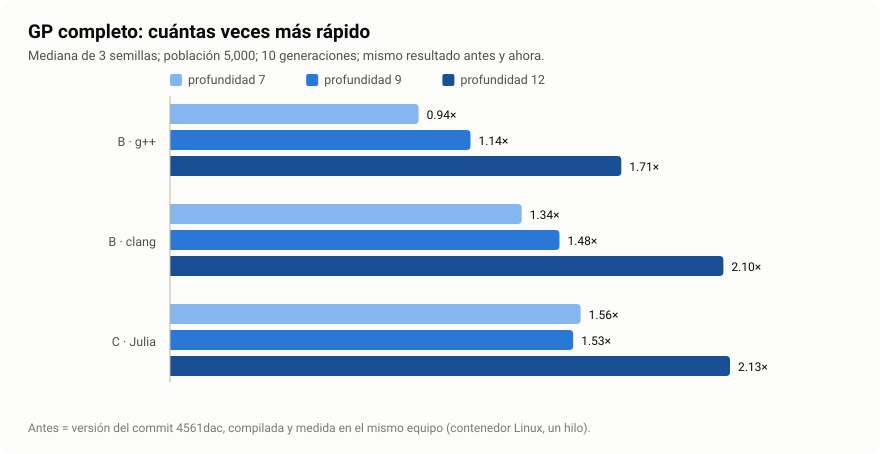

| GP completo (s) | B antes g++ | B ahora g++ | B antes clang | B ahora clang | C antes | C ahora |
|---|---|---|---|---|---|---|
| profundidad 7 | 0.87 | 0.92 | 0.88 | 0.66 | 0.63 | 0.40 |
| profundidad 9 | 3.11 | 2.72 | 3.09 | 2.09 | 1.29 | 0.84 |
| profundidad 12 | 31.20 | 18.20 | 31.40 | 14.94 | 6.01 | 2.83 |

En profundidad 7 con g++ la diferencia está dentro del ruido de medición (otras corridas de
la misma versión dieron 0.74-0.80 s).

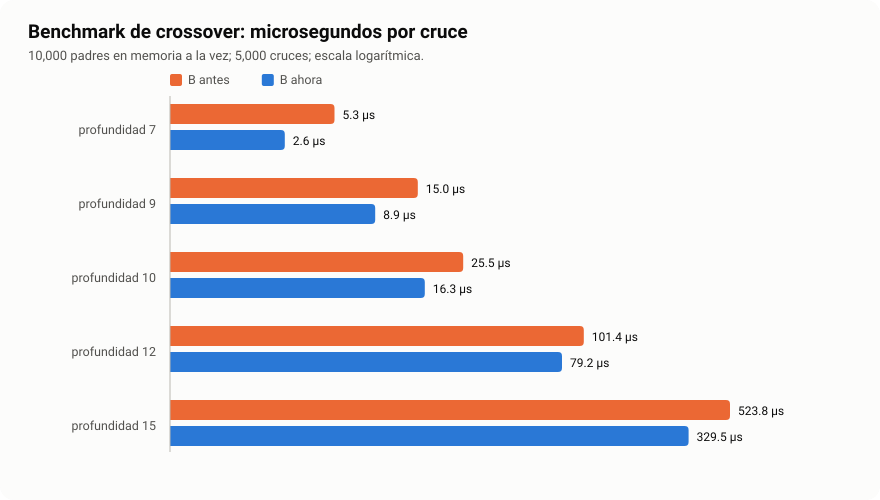

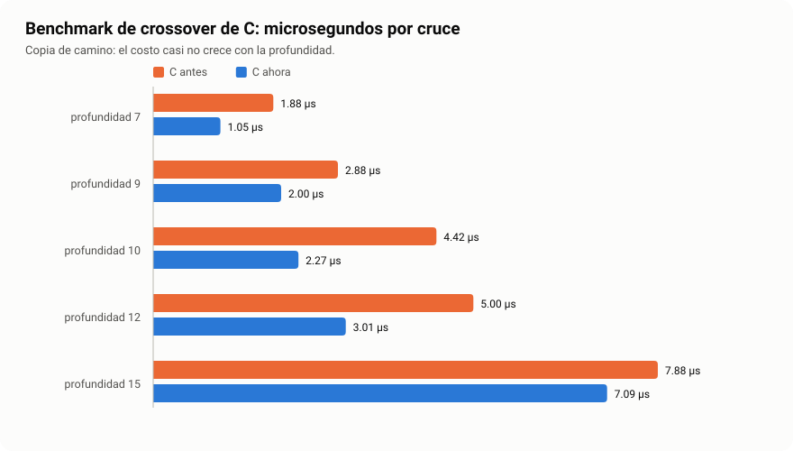

| Crossover (µs por cruce) | B antes | B ahora | C antes | C ahora |
|---|---|---|---|---|
| profundidad 7 | 5.30 | 2.61 | 1.88 | 1.05 |
| profundidad 9 | 14.99 | 8.92 | 2.88 | 2.00 |
| profundidad 10 | 25.55 | 16.29 | 4.42 | 2.27 |
| profundidad 12 | 101.36 | 79.16 | 5.00 | 3.01 |
| profundidad 15 | 523.83 | 329.47 | 7.88 | 7.09 |

¿Dónde se iba el tiempo de B antes de estos cambios?

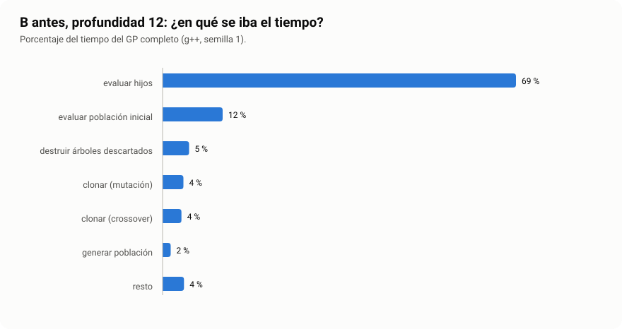

**Mejor MSE.** Dentro de cada implementación, antes y ahora dan el mismo mejor MSE con la
misma semilla, excepto B entre versiones: el orden estable (B8) cambia el orden de los
sobrevivientes. Las corridas de B tampoco coinciden entre compiladores con bibliotecas
estándar distintas (MSVC contra g++), porque `std::uniform_int_distribution` se implementa
distinto; clang-cl usa la de MSVC.

### 7.2 Protocolo actual, equipo de pruebas (Windows), dataset3a

AMD Ryzen 7 170, 15.3 GB de RAM, Windows 11, MSVC (x64-Release) y Julia 1.13.4 con `-O3`,
un hilo, población 5,000, semilla 5, un proceso por profundidad.

| GP completo, C, 100 generaciones | Prof. 7 | Prof. 9 | Prof. 12 |
|---|---|---|---|
| Tiempo | 38.7 s | 50.3-53.4 s | 101.5-112.2 s (una corrida dio 131.8 s por ruido externo) |
| Mejor MSE | 0.10998153 | 0.103945666 | 0.125202855 |

En C la semilla importa: con las semillas 1 a 5, 7, 11, 42, 123 y 2026, la suma de las tres
profundidades fue de 199 s (semilla 5, la más rápida y con el mejor MSE) a 267 s.

| GP completo, B, 100 generaciones | Prof. 12 |
|---|---|
| Tiempo | 1,115.7 s (18.6 min) |
| Mejor MSE | 0.411568995 |

En profundidad 12, C es unas 10.6 veces más rápido que B (105 s contra 1,116 s). El MSE de
B no se compara semilla por semilla con el de C: B usa otro generador aleatorio, así que con
la semilla 5 hace otra corrida. Con 10 generaciones B tardaba unos 17 s por generación; con
100, el promedio baja a unos 11 s, porque al converger la población el corte temprano y los
hijos idénticos a su padre ahorran más.

| Crossover (µs por cruce, 10,000 árboles en memoria) | Prof. 7 | Prof. 9 | Prof. 10 | Prof. 12 | Prof. 15 |
|---|---|---|---|---|---|
| B | 4.6-4.9 | 14.8-15.3 | 25.7-25.9 | 83-85 | 490-570 |
| C | 0.71-0.79 | 0.99-1.20 | 1.14-1.32 | 1.63-1.87 | 2.6-2.9 |

(El crossover no depende del dataset; medido con 5 semillas en la versión del 20 de
noviembre.)

### 7.3 Sobre el MSE con dataset3a

dataset3a es exactamente `sin(sqrt(x1² + x2²))` en una cuadrícula de 31 × 31 puntos en
[-5, 5]² (el error con esa función es del orden de 10⁻³²). Los operadores del manual
(`+ − × ÷ √`) no incluyen seno, así que ninguna implementación puede llegar a MSE 0: solo
aproximarla. Referencias para leer el MSE:

| Modelo | MSE | Varianza explicada |
|---|---|---|
| Una constante (la media) | 0.466 | 0% |
| Regresión lineal en x1 y x2 | 0.466 | 0% |
| GP, semilla 5, 100 generaciones | 0.104-0.125 | 73-78% |
| Polinomio de grado 5 (21 términos, mínimos cuadrados) | 0.035 | 93% |

Algunas corridas se quedan cerca de una constante (MSE 0.43-0.47); esa variación entre
semillas es típica de la GP clásica. A, B y C dan exactamente el mismo MSE para el mismo
árbol: un MSE alto no indica un error de implementación sino un límite del algoritmo y de
los operadores del manual.

### 7.4 Comparación con otros sistemas

La medida usual es cuántos nodos por fila se evalúan por segundo (GPops/s):

| Sistema | Velocidad | Cómo |
|---|---|---|
| B | 0.35-0.5 × 10⁹ (2.0-2.9 ns por nodo y fila) | fila por fila, 1 hilo, sin SIMD |
| C | ~2-3 × 10⁹ equivalentes (estimado: hace en 37 s lo que a B le toma 204 s) | cache y subárboles compartidos, 1 hilo |
| DynamicExpressions.jl (base de PySR) | ~1 × 10⁹ (607 ns para 6 nodos × 100 filas) | evaluación por lotes |
| Intérprete MIMD con AVX2 (de Melo et al.) | 7.5 × 10⁹ en un núcleo | SIMD |
| GPquick (Langdon) | 139 × 10⁹ con 48 hilos | SIMD AVX-512 y hilos |
| DEAP (Python) | ~6 × 10⁴ nodos/s (comparación de easyFastGP) | intérprete en Python |

B está a unas 2 veces de los sistemas por lotes y a unas 15 de los SIMD de un núcleo: esa
distancia es la esperada, porque la evaluación por lotes y el paralelismo están
prohibidos. Frente a herramientas en Python está varios órdenes de magnitud arriba. C se
acerca a los SIMD de un núcleo sin usar SIMD. Fuentes: de Melo et al., "A MIMD interpreter
for Genetic Programming" (EvoApplications 2020); Langdon y Banzhaf, "Faster Genetic
Programming GPquick via multicore and Advanced Vector Extensions" (2019); documentación de
DynamicExpressions.jl; README de easyFastGP; Burlacu, "Zobrist Hash-based Duplicate
Detection in Symbolic Regression" (2025).

---

## 8. Cómo reproducir

```bash
# B (Linux; en Windows ver GP_CPP20_B/README.md)
cmake -S GP_CPP20_B -B build -DCMAKE_BUILD_TYPE=Release && cmake --build build
./build/gp_b --test
# GP completo: un comando por profundidad (7, 9 y 12), 100 generaciones
./build/gp_b --bench-gp --data=datos/dataset3a.csv --population=5000 --depths=7 --generations=100 --history=historial_B_7.csv
./build/gp_b --bench-crossover --trees=10000 --depths=7,9,10,12,15 --variables=2

# C y A
julia --startup-file=no -O3 GP_JL_C/main.jl --test
julia --startup-file=no -O3 GP_JL_C/tools/cross_check.jl
julia --startup-file=no -O3 GP_JL_C/tools/verificar_con_b.jl ./build/gp_b
julia --startup-file=no -O3 GP_JL_C/main.jl --bench-gp --data=datos/dataset3a.csv --population=5000 --depths=7 --generations=100 --history=historial_C_7.csv

# Sin las dos optimizaciones pendientes de confirmar con el profesor (mismo resultado)
./build/gp_b --bench-gp ... --no-fold --no-cut
julia GP_JL_C/main.jl --bench-gp ... --no-fold --no-cut

# C sin lista postfija ni cache al reusarse (versión anterior; mismo resultado)
julia GP_JL_C/main.jl --bench-gp ... --no-tape --reuse-min-size=0
```

En Windows, `correr_benchmarks.ps1` hace todo (pruebas, verificación cruzada y
benchmarks); `-SinPendientes` mide sin plegado ni corte temprano. Corre cada profundidad
del GP en un proceso aparte, con 100 generaciones, y guarda el mejor MSE de cada generación
en `gp_historial_<impl>.csv`.

**Regenerar las figuras** (Python 3, sin paquetes externos):

```bash
python3 docs/tools/resumir_resultados.py > docs/tools/resultados.json
python3 docs/tools/generar_figuras.py docs/tools/resultados.json
```

---

## 9. Glosario

| Término | Significado |
|---|---|
| **Bit a bit** | Dos números `Float64` con exactamente los mismos 64 bits: no "casi iguales", idénticos |
| **Cache del procesador** | Memorias pequeñas y rápidas (L1, L2, L3) junto al procesador; leer de ahí es decenas de veces más rápido que de la RAM |
| **Cache de resultados** | (De C.) El valor de un subárbol guardado para cada fila, para no recalcularlo |
| **Copia de camino** | Crear un árbol modificado copiando solo los nodos de la raíz al cambio y compartiendo el resto |
| **DAG** | Grafo dirigido sin ciclos: como un árbol, pero un nodo puede tener varios padres (subárboles compartidos) |
| **Elitismo** | El mejor individuo nunca se pierde entre generaciones |
| **GPops/s** | Operaciones de GP por segundo: nodos evaluados por fila, por segundo |
| **Hijo idéntico a su padre** | Hijo cuyo árbol es igual al de un padre (por ejemplo, un crossover que intercambia dos hojas `x1`); recibe el MSE del padre |
| **`isbits`** | En Julia, un tipo sin referencias a otros objetos: se guarda "en línea" dentro de un arreglo |
| **JIT** | Compilación "justo a tiempo": Julia compila cada función la primera vez que se usa |
| **Montículo (heap)** | Estructura que da el máximo de un conjunto en O(1) y lo actualiza en O(log n) |
| **MSE** | Error cuadrático medio: promedio de (y − predicción)² |
| **Plegado de constantes** | Calcular una vez el valor de un subárbol sin variables |
| **Predicción de saltos** | El procesador adivina el resultado de cada `if`/`switch` para no esperar; fallar cuesta ~15-20 ciclos |
| **Preorden** | Orden raíz → subárbol izquierdo → subárbol derecho |
| **Recolector de basura (GC)** | Parte de Julia que libera los objetos que ya nadie usa; revisa los objetos vivos |
| **Registro de 24 bytes** | (De C.) `NodeRec`: los datos de un nodo, sin punteros, dentro de un arreglo |
| **S** | (De C.) Tamaño mínimo de subárbol que guarda cache |
| **Torneo binario** | Elegir dos individuos al azar y quedarse con el mejor |
